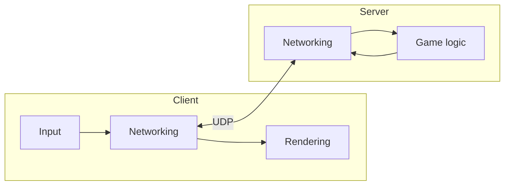
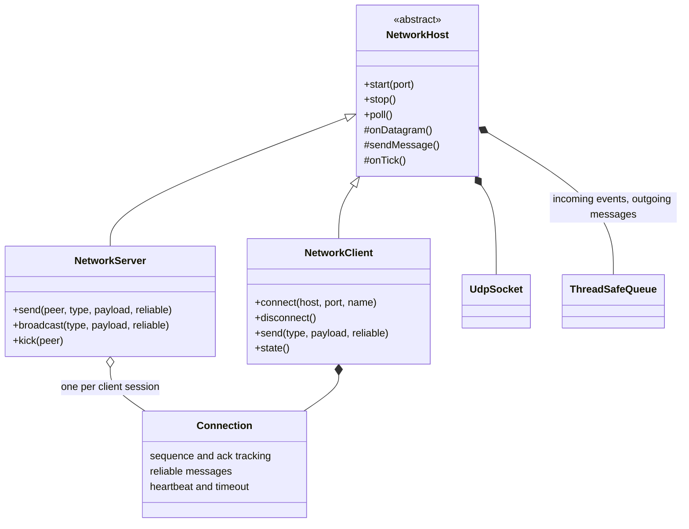
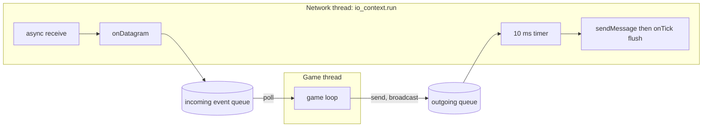

# Architecture

> Keep it high level: subsystems and how they interact, not every class.

## Subsystems

### Networking

The networking layer is split between the generic UDP transport and the R-Type protocol. `rtype_network` contains the socket, session, acknowledgement, and timeout logic without any gameplay knowledge. `rtype_protocol` owns the message definitions and binary serializers used on the wire; game code never reads raw packet bytes directly. Both `NetworkServer` and `NetworkClient` inherit from `NetworkHost`, and each runs a single network thread driven by an `asio::io_context`. The game loop only interacts with them through a thread-safe incoming event queue and an outgoing message queue.

This structure keeps the transport state machine and socket I/O off the main simulation thread. `NetworkHost` owns the UDP socket and the periodic tick timer, receives datagrams as they arrive, and dispatches them to `NetworkServer` or `NetworkClient`. In turn, those classes decide whether to accept a session, reject a handshake, queue a reliable message, or forward incoming game data to the rest of the project. See [protocol.md](protocol.md) and [network-client.md](network-client.md).

`NetworkHost` also owns the two thread-safe queues used by the game thread: one for incoming `NetworkEvent`s and one for outbound `OutgoingMessage`s. The network thread drains the outgoing queue and flushes packets on a 10 ms tick, while the game thread drains events with `poll()` and sends commands with `send()` or `broadcast()`. The generic packet framing helpers are `PacketHeader`, `PacketCodec`, and the byte reader/writer pair, which handle endianness and bounds checks before the game layer sees any payload.

One sentence on helpers: `PacketHeader` defines the 16-byte UDP header, `PacketCodec` frames messages into a datagram, and `ByteWriter` / `ByteReader` serialize big-endian values with bounds checks.

### Game logic

### Rendering

The presentation subsystem lives in `gui/`, behind the `IGui` interface.
Its presentation types are defined in `GuiTypes.hpp` without exposing raylib types.

The client owns the main loop and supplies a `RenderScene` containing sprites
and text. The GUI renders this data without handling network packets or
gameplay rules.

`Gui` coordinates window management, rendering and visual resources.
`Window` manages the window lifecycle and frame timing. `Renderer` draws the
provided scene, while `ResourceManager` owns textures and fonts and releases
them before the window closes.

The client can enable and configure a scrolling starfield. The GUI updates its
visual offset using elapsed time and repeats the background across the current
window size without scaling entity coordinates.

The GUI samples keyboard input and maps it to player actions through
`InputMapper`. The client receives action states and can configure bindings
without raylib key codes. See [controls](controls.md).

The client supplies sound events through `IGui`. `AudioSystem` owns the audio
device, sound resources and concurrent playback voices. Audio failures do not
prevent rendering. See [audio](audio.md) for lifecycle and configuration.
