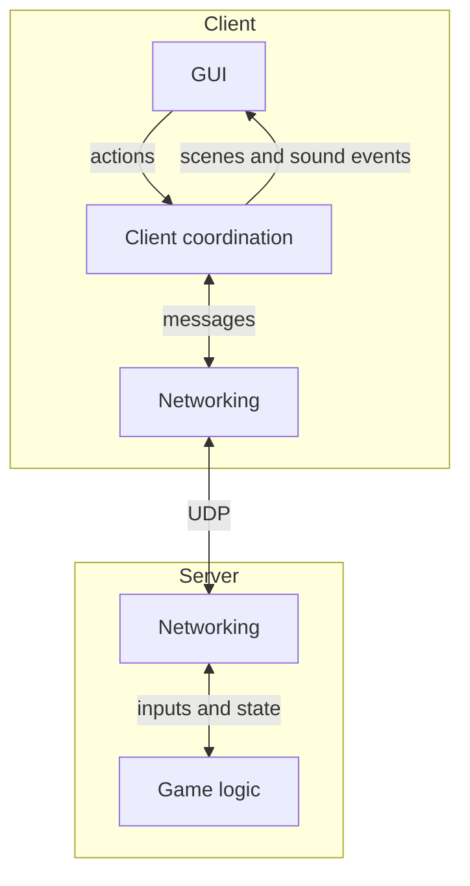
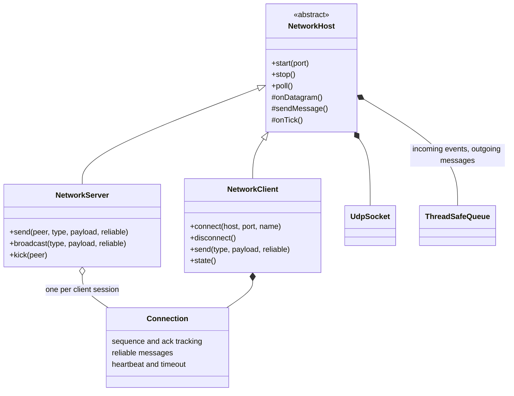
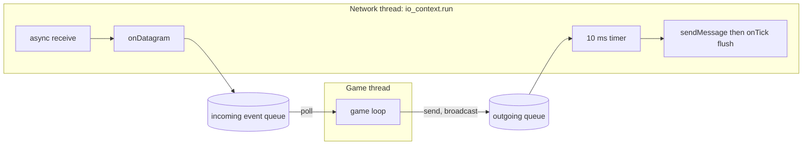

# Architecture

> Keep it high level: subsystems and how they interact, not every class.

The GUI supplies actions to client coordination, which builds scenes and sound
events from server state. Client and server network layers exchange UDP
messages; gameplay decisions remain in the server simulation.

## Subsystems

### Networking

The networking layer is split between the generic UDP transport and the R-Type protocol. `rtype_network` contains the socket, session, acknowledgement, and timeout logic without any gameplay knowledge. `rtype_protocol` owns the message definitions and binary serializers used on the wire; game code never reads raw packet bytes directly. Both `NetworkServer` and `NetworkClient` inherit from `NetworkHost`, and each runs a single network thread driven by an `asio::io_context`. The game loop only interacts with them through a thread-safe incoming event queue and an outgoing message queue.

This structure keeps the transport state machine and socket I/O off the main simulation thread. `NetworkHost` owns the UDP socket and the periodic tick timer, receives datagrams as they arrive, and dispatches them to `NetworkServer` or `NetworkClient`. In turn, those classes decide whether to accept a session, reject a handshake, queue a reliable message, or forward incoming game data to the rest of the project. See [protocol.md](protocol.md) and [network-client.md](network-client.md).

`NetworkHost` also owns the two thread-safe queues used by the game thread: one for incoming `NetworkEvent`s and one for outbound `OutgoingMessage`s. The network thread drains the outgoing queue and flushes packets on a 10 ms tick, while the game thread drains events with `poll()` and sends commands with `send()` or `broadcast()`. The generic packet framing helpers are `PacketHeader`, `PacketCodec`, and the byte reader/writer pair, which handle endianness and bounds checks before the game layer sees any payload.

The class diagram below shows shared transport ownership: both endpoints
inherit from NetworkHost, while each active connection tracks reliability state.
Queues connect the network and game threads.

The following flow separates threads: outgoing commands are drained by the
network tick, while incoming events wait in a queue until the game loop polls.
The game loop does not perform socket I/O directly.

One sentence on helpers: `PacketHeader` defines the 16-byte UDP header, `PacketCodec` frames messages into a datagram, and `ByteWriter` / `ByteReader` serialize big-endian values with bounds checks.

### Game logic

See [ECS architecture](ecs-architecture.md) for components and systems, and
[engine and algorithms](engine-and-algorithms.md) for implementation choices.

### Rendering

The presentation subsystem lives in `gui/`, behind `IGui` and native-independent
types in `GuiTypes.hpp`. Client coordination decodes server state and submits
complete scenes and sound events. The GUI owns window management, rendering,
resources, local input, audio and Settings without deciding gameplay results.

Client coordination also owns the connection and lobby lifecycle in `ClientSession`.
It supplies frontend state and receives interface commands; `FrontendMenu` in
`gui/` handles editing, navigation and drawing. Server lobby messages decide when
the client enters gameplay. See [client interface](client-interface.md).

The client requests a 1920 x 1080 window. The native window preserves 16:9,
and the GUI scales the logical world to fit while keeping HUD coordinates in
window pixels. See [GUI and client presentation](gui.md) for responsibilities,
code locations, frame order and resource lifecycle, and the
[GUI how-to](how-to/use-gui.md) for practical integration.
