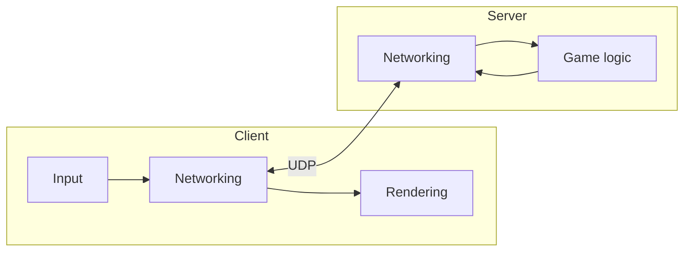

# Architecture

> TODO: fill in once the architecture is decided. Keep it high level: subsystems and how they
> interact, not every class.

## Subsystems

### Networking

### Game logic

### Rendering

The GUI lives in `gui/` and is exposed through `rtype::gui`.
`IGui.hpp` defines the client interface, while `GuiTypes.hpp` contains
presentation data. `Gui` implements the interface and `Window` manages
window creation and cleanup. Public headers do not expose raylib types.

The client drives the rendering loop. The current implementation displays
a clear color and handles resizing and closure through Escape or the close
button. Coordinates use window pixels without automatic scaling.
Frame duration is provided in seconds.

Input mapping, sprite rendering, text and audio playback are implemented
separately. GUI does not decode network packets or implement gameplay rules.
