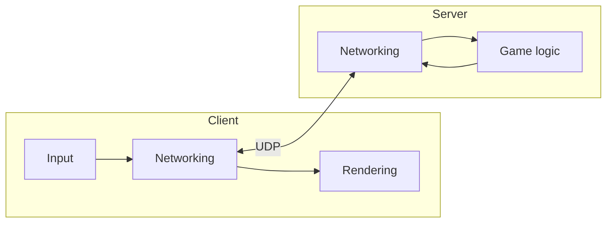

# Architecture

> TODO: fill in once the architecture is decided. Keep it high level: subsystems and how they
> interact, not every class.

## Subsystems

### Networking

### Game logic

### Rendering

The presentation subsystem lives in `gui/`, behind the `IGui` interface.
Its presentation types are defined in `GuiTypes.hpp` without exposing raylib types.

The client owns the main loop and supplies a `RenderScene` containing sprites
and text, with optional status feedback. The GUI renders this data without
handling network packets or
gameplay rules.

`Gui` coordinates window management, rendering and visual resources.
`Window` manages the window lifecycle and frame timing. `Renderer` draws the
provided scene. `StatusPresenter` builds status pages that replace the game view.
`ResourceManager` owns textures and fonts and releases
them before the window closes.

The client can enable and configure a scrolling starfield. The GUI updates its
visual offset using elapsed time and repeats the background across the current
window size without scaling entity coordinates.

The GUI samples keyboard input and maps it to player actions through
`InputMapper`. The client receives action states and can configure bindings
without raylib key codes. See [controls](controls.md).

The client supplies sound events through `IGui`. `AudioSystem` owns the audio
device, sound resources and concurrent playback voices. Audio failures do not
prevent rendering. See [audio](audio.md) for lifecycle and configuration.
