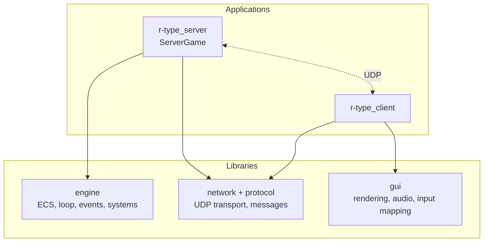
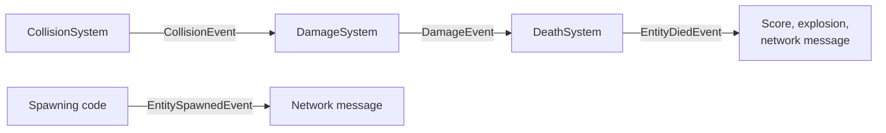

# ECS architecture

How the engine is organized, and where to find each piece in the code.
For the reasons behind the ECS choice, see the
[engine architecture and algorithms study](engine-and-algorithms.md).

## Contents

1. [Layers](#1-layers)
2. [Core building blocks](#2-core-building-blocks)
3. [Components](#3-components)
4. [Archetypes (entity factory)](#4-archetypes-entity-factory)
5. [Systems](#5-systems)
6. [Execution order and event flow](#6-execution-order-and-event-flow)
7. [Server systems versus client systems](#7-server-systems-versus-client-systems)
8. [Where is what](#8-where-is-what)
9. [How-to](#9-how-to)

---

## 1. Layers



*Text description: there are two applications, the server and the client. The
server uses the engine (game state and logic) and the network libraries. The
client uses the network libraries and the gui library (rendering, audio,
input). The server and the client talk to each other only through UDP. The
engine does not depend on networking or rendering.*

| Layer | Directory | Role |
|---|---|---|
| Engine | `engine/` | Entities, components, systems, fixed-step loop, events, entity factory. No network, no graphics. |
| Network and protocol | see [architecture.md](architecture.md#networking) | UDP transport and binary messages. |
| GUI | `gui/` | Window, drawing, audio, key mapping, behind the `IGui` interface. |
| Server | `ServerGame` | Owns one `Registry` and one `Update` loop; turns network events into game state. The server has the final say on the game. |
| Client | `r-type_client` | Sends inputs, draws the state received from the server. |

## 2. Core building blocks

| Piece | What it is | Header | Source |
|---|---|---|---|
| `Entity` | An ID: an index plus a generation counter. A stale ID (for example in a late packet) is detected instead of pointing to a new entity. | `Entity.hpp` | `src/ecs/Entity.cpp` |
| `EntityManager` | Creates and destroys entity IDs, recycles indices. | `EntityManager.hpp` | `src/ecs/EntityManager.cpp` |
| `SparseSet<T>` | Storage for one component type: O(1) add/remove, contiguous data. | `SparseSet.hpp` | header only |
| `Registry` | The world: entities plus one `SparseSet` per component type. `addComponent`, `getComponent`, `hasComponent`, `each<A, B...>(callback)`, and deferred destruction (`destroyLater`, `flushDestroyed`). | `Registry.hpp` | `src/ecs/Registry.cpp` |
| `ISystem` | One piece of game logic: `update(Registry&, float dt)`. | `ISystem.hpp` | |
| `Update` | The fixed-step loop. Runs the systems in registration order, 60 steps per second, at most 5 catch-up steps per call. | `Update.hpp` | `src/core/Update.cpp` |
| `EventDispatcher` | Typed events: `publish` queues an event, `flush` delivers it to the subscribers. | `EventDispatcher.hpp` | `src/core/EventDispatcher.cpp` |
| `EntityFactory` | Creates a complete entity from an archetype name. | `EntityFactory.hpp` | `src/ecs/EntityFactory.cpp` |

All headers are in `engine/include/` (systems in `engine/include/systems/`).

## 3. Components

A component is plain data, defined in `Components.hpp`. Systems read and write
components; components contain no logic.

| Component | Fields | Meaning |
|---|---|---|
| `Position` | `x`, `y` | Where the entity is. |
| `Velocity` | `dx`, `dy` | Movement per second. |
| `Hitbox` | `width`, `height` | Rectangle used for collisions. |
| `Health` | `current`, `max` | Hit points. |
| `Hit` | `amount` | Damage waiting to be applied. Not part of any archetype: added when needed. |
| `Damage` | `value` | Damage dealt on contact. |
| `Lifetime` | `remaining` | Seconds before the entity is removed. |
| `Invincibility` | `remaining` | Seconds during which the entity cannot be hurt. |
| `NetType` | `entityId`, `entityType`, `x`, `y` | What the client needs to draw the entity. `entityType` is `Player`, `Enemy`, `Projectile`, `Effect` or `Decor`. |
| `Controllable` | `up`, `down`, `left`, `right`, `shoot` | Current input state of a player ship. |
| `PlayerOwner` | `playerId` | Which player owns the entity. The client picks the ship color or sprite from it. |
| `EnemyBehavior` | `pattern`, `speed`, `amplitude`, `frequency` | How an enemy moves. `pattern` is `Straight`, `Sine` or `Chase`. |
| `Weapon` | `cooldown`, `timer`, `projectileType`, `rate` | How and when the entity shoots. |
| `Projectile` | `owner`, `lifetime`, `pierceCount` | Who fired it, how long it lives, how many enemies it can pass through. |
| `Score` | `value`, `total` | Points. |

## 4. Archetypes (entity factory)

An archetype is a named list of components. `EntityFactory` builds the entity
in one call, so component lists are written in one place only.

| Component | `player` | `enemy_basic`<br/>`enemy_sine`<br/>`enemy_chase` | `player_missile`<br/>`enemy_missile` | `explosion` | `background` |
|---|:-:|:-:|:-:|:-:|:-:|
| `Position` | ✓ | ✓ | ✓ | ✓ | ✓ |
| `Velocity` | ✓ | ✓ | ✓ | | ✓ |
| `Health` | ✓ | ✓ | | | |
| `Hitbox` | ✓ | ✓ | ✓ | | |
| `Damage` | | ✓ | ✓ | | |
| `Controllable` | ✓ | | | | |
| `PlayerOwner` | ✓ | | | | |
| `EnemyBehavior` | | ✓ | | | |
| `Weapon` | ✓ | ✓ | | | |
| `Score` | ✓ | ✓ | | | |
| `Invincibility` | ✓ | | | | |
| `Projectile` | | | ✓ | | |
| `Lifetime` | | | ✓ | ✓ | |
| `NetType` | ✓ | ✓ | | ✓ | ✓ |

*Text description: the table lists, for each archetype, which components the
factory adds. For example, `player` has ten components (everything except
`Damage`, `EnemyBehavior`, `Projectile` and `Lifetime`), and `explosion` has
only three: `Position`, `Lifetime` and `NetType`.*

The factory decides **which** components an entity has. The caller decides
their **values** through `ComponentParams`; a field that is not set keeps the
default value of the component. The engine contains no gameplay numbers.

```cpp
engine::EntityFactory factory(registry);

const Entity ship = factory.create("player", {
    .position = {150.F, 200.F},
    .health   = Health{3, 3},
    .hitbox   = Hitbox{64.F, 32.F},
    .playerId = 1,
});
```

Fields of `ComponentParams` must be written in their declaration order (a C++20
rule for designated initializers). An unknown name throws
`std::invalid_argument`. The enemy pattern comes from the archetype name
(`enemy_sine` gives `Sine`) unless `.behavior` is given.

## 5. Systems

A system is a class that implements `ISystem` and works on every entity that has
the components it needs. Headers are in `engine/include/systems/`, sources in
`engine/src/systems/`.

| System | Role | Main components |
|---|---|---|
| `InputSystem` | Turns the input state of a player into a velocity. | `Controllable`, `Velocity` |
| `EnemyBehaviorSystem` | Moves enemies following their pattern. | `EnemyBehavior`, `Velocity`, `Position` |
| `WeaponSystem` | Handles cooldowns and creates missiles. | `Weapon`, `Controllable`, `Position` |
| `MotionSystem` | Moves entities: position changes by velocity over time. | `Position`, `Velocity` |
| `BoundsSystem` | Deals with entities that leave the play area (configured with an area and a margin). | `Position` |
| `CollisionSystem` | Finds overlapping hitboxes and publishes `CollisionEvent`. | `Position`, `Hitbox` |
| `DamageSystem` | Applies damage after a collision and publishes `DamageEvent`. | `Health`, `Damage`, `Invincibility` |
| `DeathSystem` | Removes entities whose health reached zero and publishes `EntityDiedEvent`. | `Health` |
| `LifetimeSystem` | Counts `Lifetime` down and removes the entity at zero. | `Lifetime` |

## 6. Execution order and event flow

Systems run **in the order they are added** with `Update::addSystem`. The order
matters: a collision must be found before damage is applied.

Intended order of one step (1/60 s):

| # | Step | System |
|---|---|---|
| 1 | Input | `InputSystem` |
| 2 | Behavior | `EnemyBehaviorSystem` |
| 3 | Weapons | `WeaponSystem` |
| 4 | Motion | `MotionSystem`, `BoundsSystem` |
| 5 | Collision | `CollisionSystem` |
| 6 | Damage | `DamageSystem` |
| 7 | Death | `DeathSystem` |
| 8 | Cleanup | `LifetimeSystem`, deferred destruction (`flushDestroyed`) |
| 9 | Spawn | Waves of enemies (server game logic) |

Registered today by `ServerGame`: `InputSystem`, `MotionSystem`, `BoundsSystem`.
The other systems are added to the same list as they are connected.



*Text description: events let systems react to each other without knowing each
other. The collision system publishes a collision event, which the damage
system reads. The damage system publishes a damage event, which the death
system reads. The death system publishes an entity-died event, used for score,
an explosion and the message sent to the clients. When an entity is spawned, an
entity-spawned event is used to build the network message.*

Rules that keep this predictable:

- Events are queued with `publish` and delivered at one point of the step
  (`EventDispatcher::flush`), never in the middle of another system's loop.
- Entities are removed with `Registry::destroyLater` and really destroyed with
  `flushDestroyed` at the end of the step, so no system iterates over a
  destroyed entity.
- Systems count time with the step duration `dt`, never with frames.

## 7. Server systems versus client systems

The server is authoritative: only the server decides collisions, damage and
deaths. The client only draws what the server sends.

| Where | What | Code |
|---|---|---|
| Server | All gameplay systems of section 5, run by `Update` inside `ServerGame`. | `engine/` and `ServerGame` |
| Server | Network events (`Connected`, `Disconnected`, `MessageReceived`) turned into game state. | `ServerGame` |
| Client | Rendering (`Renderer`, `StatusPresenter`), audio (`AudioSystem`), key mapping (`InputMapper`). They exist only on the client; the server builds and runs without any graphics library. | `gui/` |

## 8. Where is what

```
engine/
├── CMakeLists.txt
├── include/                  public headers
│   ├── Components.hpp        all components
│   ├── Entity*.hpp, Registry.hpp, SparseSet.hpp, IComponentStorage.hpp
│   ├── EntityFactory.hpp     archetypes
│   ├── EventDispatcher.hpp, Events.hpp
│   ├── ISystem.hpp, Update.hpp
│   └── systems/              one header per system
└── src/
    ├── core/                 Update, EventDispatcher
    ├── ecs/                  Entity, EntityManager, Registry, EntityFactory
    └── systems/              one source file per system
```

| I want to... | Look at |
|---|---|
| See or add a component | `include/Components.hpp` |
| See what an entity is made of | `src/ecs/EntityFactory.cpp` |
| Change a game rule | `src/systems/<Name>System.cpp` |
| Change the order of systems | `ServerGame` constructor (`addSystem` calls) |
| Add an event type | `include/Events.hpp` |

## 9. How-to

### Add a component

1. Add a plain struct to `Components.hpp`, with default values.
2. Add it to the archetypes that need it in `EntityFactory.cpp`, and to
   `ComponentParams` if callers must be able to set its data.
3. Add it to the tables in sections 3 and 4 of this page.

### Add an archetype

Add a builder function in `EntityFactory.cpp` and register it in the
`EntityFactory` constructor with `registerArchetype("name", builder)`. A game can
also register its own archetypes at runtime without changing the engine. Add a
test in `tests/test_entity_factory.cpp`.

### Add a system

1. Create `include/systems/MySystem.hpp` and `src/systems/MySystem.cpp`, with a
   class that implements `ISystem::update(Registry&, float dt)`.
2. Use `registry.each<A, B>(...)` to visit the entities that have components
   `A` and `B`.
3. Add the source file to `engine/CMakeLists.txt`.
4. Register it with `addSystem` at the right place in the order of section 6.
5. Add a row to the system table in section 5.