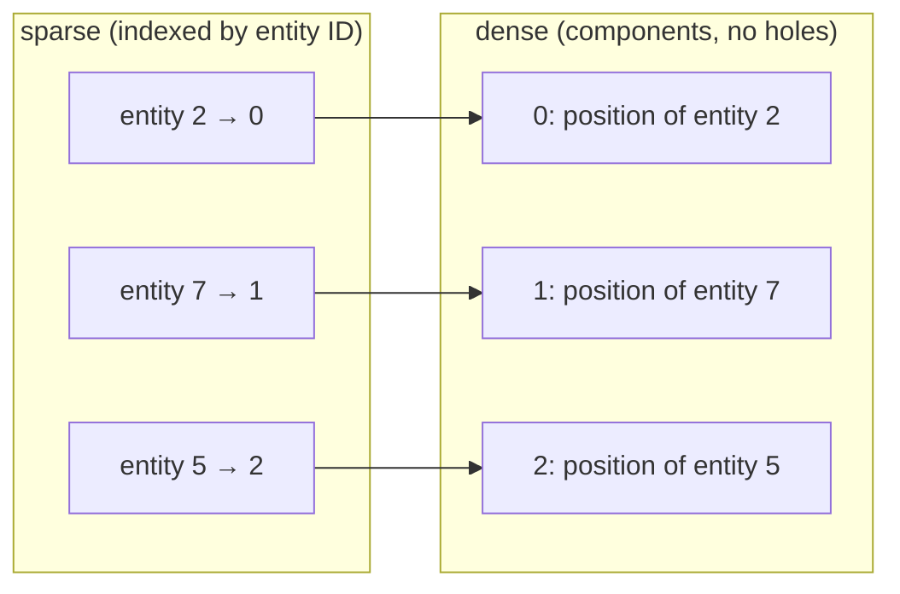
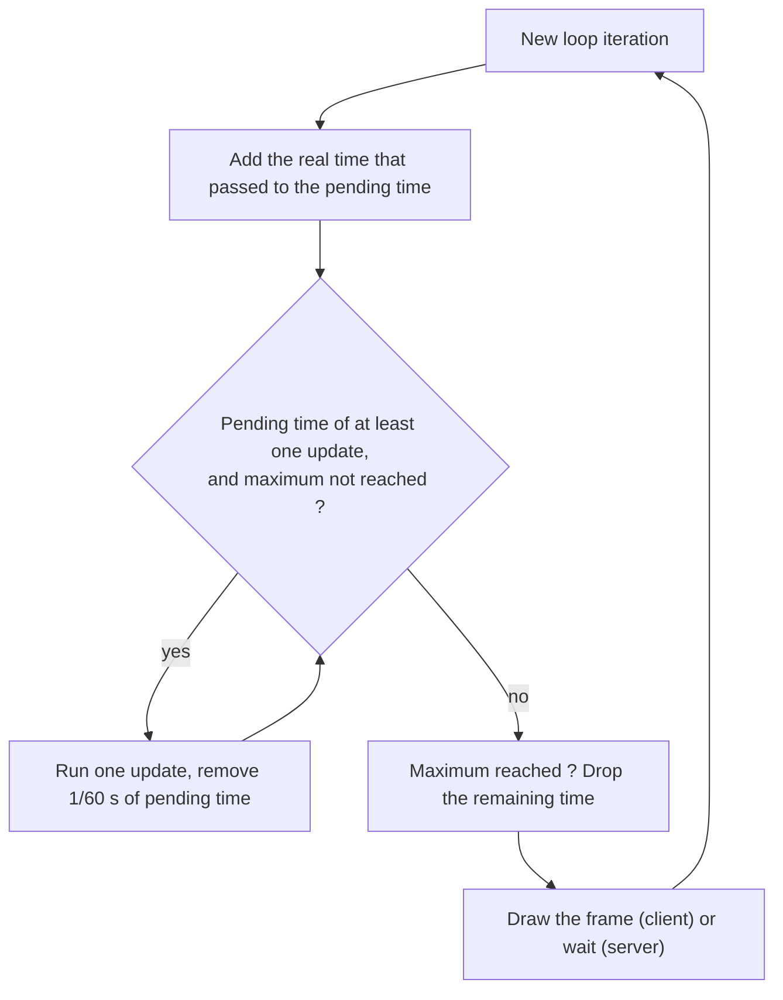

# Technical & comparative study: engine architecture and algorithms

For each choice: the alternatives considered, the comparison, and why we picked what we picked.

## Contents

1. [Engine architecture](#1-engine-architecture)
2. [Algorithms & data structures](#2-algorithms--data-structures)
   - [2.1 ECS component storage](#21-ecs-component-storage)
   - [2.2 Collision detection](#22-collision-detection)
   - [2.3 Game loop](#23-game-loop)
   - [2.4 Communication between systems](#25-communication-between-systems)
   - [2.5 Summary](#26-summary)
3. [Decision and implementation consequences](#3-decision-and-implementation-consequences)
4. [References](#4-references)

## Evaluation criteria

We compare the options on the axes that matter for this project: decoupling of systems, performance with many short-lived entities (missiles), ease of replicating state over the network, multithreading, support for data-driven content, reusability (the engine must serve a second game) and implementation effort within the six-week timeframe.

The ratings in the architecture table (Excellent, Good, Medium, Poor) are a qualitative assessment by the team, based on the documentation and articles listed in the references. Performance statements come from the literature and the documentation of the technologies, not from benchmarks of our own.

---

# 1. Engine architecture

To build a modular, high-performance R-Type engine capable of handling multiple concurrent entities while synchronizing with an authoritative server, we evaluated several architectural patterns.

| Criterion | **ECS** | OOP Inheritance | Classic Component (Unity-like) | Actor + Components (Unreal-like) | Scene Graph (Godot-like) | Actor Model (Messages) | Manual DOD |
|---|---|---|---|---|---|---|---|
| **Principle** | Entities = IDs, components = data, systems = logic | Class hierarchy | Objects with components having an `update()` | Actors + components with built-in replication | Node tree | Isolated units communicating via messages | Arrays of structs by type |
| **Decoupling** | Excellent | Poor | Medium | Good | Poor | Excellent | Medium |
| **Performance** (many missiles) | Excellent | Poor | Medium | Medium | Poor | Medium | Excellent |
| **Network / Snapshots** | Simple (component replication) | Difficult | Medium | Good (engine-bound) | Difficult | Natural (messages) | Simple but non-generic |
| **Multithreading** | Good (independent systems) | Difficult | Difficult | Difficult | Difficult | Natural | Good |
| **Data-Driven Content** | Very good | Poor | Good | Good | Medium | Medium | Poor |
| **Reusability** (engine + 2nd game) | Excellent | Poor | Medium | Medium | Medium | Good | Very poor |
| **Simplicity / Timeframe** | Medium | Excellent | Good | Poor | Good | Poor | Good |
| **Verdict** | **Chosen** | Too rigid | Logic coupled to data | Too heavy, engine-specific | Unnecessary hierarchy for server | Useful for instances, not entities | Non-generic |

**Choice:** **ECS (Entity Component System)**.

**Why:** strict separation between data and logic, optimal performance with numerous simultaneous projectiles, and straightforward network state replication per component.

**Limitations of ECS:**
- More indirection than plain objects: behavior is spread across systems, so following one feature means reading several files.
- Debugging is less direct: there is no single object to inspect, only IDs and component pools.
- The order of systems matters and must be defined explicitly (for example, collision before damage).
- Relations between entities (a missile and its owner) must be stored as entity IDs, and checked with the generation counter.

**Closest alternatives:**
- *Classic component (Unity-like)* keeps logic inside each component, which couples data and logic and makes replication harder.
- *Manual data-oriented design* gives the same performance but would be written for R-Type only, which breaks the reusability requirement.

## 1.1 Writing our own ECS or using an existing library

Once ECS is chosen, there is a second question: do we write the core ourselves, or use an existing C++ ECS library such as EnTT or flecs?

| Option | Advantages | Drawbacks |
|---|---|---|
| **Write our own core** | Full control over the design (server/client split, network IDs, event system); every team member understands the code; matches the subject, which asks for an engine of our own design; the engine can be delivered as a standalone project with no extra dependency | More work in the first weeks; fewer features than a mature library; we must write the tests and benchmarks ourselves |
| EnTT (sparse-set based, header-only) | Mature and heavily tested; same storage model as our choice | The team would learn the library instead of designing the engine; part of the engine architecture would be hidden behind a third-party API |
| flecs (archetype based) | Rich features (queries, relationships, tooling) | Heavier and more complex; archetype model rejected for this project (see 2.1) |

**Choice:** write our own small ECS core, using the same storage model as EnTT (sparse sets), and keep it behind a narrow interface (`Registry`, `ISystem`, `Update`).

**Why:** the subject asks for a game engine of our own design, and the Advanced Architecture track evaluates the quality of its abstractions and its reusability. The size of the core is small (entities, sparse sets, registry, fixed-step loop, event dispatcher, entity factory), so the cost is acceptable. Because the interface is narrow, replacing our core with a library later would not change the game code.

---

# 2. Algorithms & data structures

For each topic: the options we considered, our choice, and why.

## 2.1 ECS component storage

| Option | Add / remove | Iteration | Complexity |
|---|---|---|---|
| `unordered_map<Entity, T>` | O(1) | Slow (cache misses) | Low |
| Sparse array (`vector<optional<T>>`) | O(1) | Medium (holes) | Low |
| **Sparse set** (`vector<T>` dense + `vector<size_t>` sparse) | O(1) | Fast (contiguous) | Medium |
| Archetypes (one table per component combination) | Costly (entity copied to another table) | Fastest | High |

**Choice:** one sparse set per component type.

**Why:** missiles appear and disappear all the time, so adding and removing components must be cheap. A sparse set does that in O(1) and keeps data in a packed array, which is fast to iterate. Archetypes iterate slightly faster, but every component change moves the entity to another table, and the implementation is much heavier for this project. The iteration ratings come from the literature, not from our own measurements.

Entity IDs are an index plus a generation counter, so an old ID (for example in a late network packet) is detected as invalid instead of pointing to a new entity.

How a sparse set works, with three entities (2, 7 and 5) that have a position:

*Text description: the `sparse` array gives the position of an entity's component in the `dense` array, in O(1). Systems iterate over `dense` directly. To remove an entity, its slot is filled with the last element of `dense`, so there are never holes.*

## 2.2 Collision detection

| Option | Cost | Note |
|---|---|---|
| All pairs | O(n²) | Too slow with many missiles |
| **Uniform grid** | O(n) | Simple, rebuilt every tick |
| Quadtree | O(n log n) | Overkill for similar-sized objects |

**Choice:** uniform grid to find candidate pairs, then an AABB (rectangle) test.

**Why:** R-Type hitboxes are rectangles of similar size, so a grid is enough and easy to rebuild each tick. Fast missiles could skip over a target between two ticks, so we limit their speed per tick. Only the server decides the result of a collision (damage, death).

**Limit:** the cost is close to O(n) only when entities are spread roughly evenly over the cells. If many entities fall into the same cell (for example a crowd of enemies in one spot), that cell approaches the all-pairs cost. The cell size is configurable, so it can be tuned if this happens.

## 2.3 Game loop

| Option | Problem |
|---|---|
| Variable timestep | Result depends on CPU speed and frame rate |
| **Fixed timestep** | Needs a limit if the computer falls behind |

**Choice:** fixed timestep of 1/60 s (60 updates per second), measured with `std::chrono::steady_clock`.

**Why:**
- The game must not depend on CPU speed. With a fixed timestep, the same inputs give the same result on every machine.
- Network reasoning is easier: everything is counted in updates.
- On the client, drawing is separate from the simulation.

**How it works:** at each iteration, the real time that passed is added to a pending time. While the pending time is at least 1/60 s, the game runs one update and removes 1/60 s from it.

**Limit:** after a long freeze, making up all the lost time would take even longer. So the number of updates per iteration is capped, and the remaining time is dropped. The game slows down for a moment instead of freezing. In the code, the cap is `Update::MaxCatchUpSteps` (5 updates per iteration), and the clock can be replaced for tests.

*Text description: each iteration adds the real time that passed to the pending time. While there is at least one update of time, the game runs an update. When there is not enough time left, or the maximum is reached, the loop draws or waits, then starts again. If the maximum was reached, the extra time is dropped.*

## 2.4 Communication between systems

Systems must react to each other (a collision leads to damage, damage to death, death to score) without knowing each other.

| Option | Advantages | Drawbacks |
|---|---|---|
| Direct calls between systems | Simplest | Systems depend on each other, which breaks decoupling and reuse |
| Immediate callbacks (observer) | Reaction happens at once | Hard to follow; an entity can be destroyed in the middle of another system's loop |
| **Typed events in a queue, flushed at a defined point of the tick** | Systems only know the event types; the order of reactions is predictable; the events can also feed the network layer | Reaction is delayed to the flush point; one more concept to learn |

**Choice:** typed events sent to a queue, and flushed at a defined point of the tick.

**Why:** it keeps systems decoupled (a Mediator-style approach), and the order stays easy to reason about. The same events (entity spawned, entity died) are used to build network messages, so replication does not need a second mechanism. Together with deferred destruction at the end of the tick, it also avoids destroying an entity while a system is iterating over it.

## 2.5 Summary

| Topic | Choice |
|---|---|
| Engine architecture | ECS, own core |
| ECS storage | Sparse set, index + generation IDs |
| Collisions | Uniform grid + AABB |
| Game loop | Fixed timestep with accumulator |
| Randomness | `mt19937` per game, timer-driven spawn |
| Communication between systems | Typed events, flushed at a defined point of the tick |

---

# 3. Decision and implementation consequences

We select an ECS with our own small core, sparse-set storage, a fixed-timestep loop, a uniform-grid collision system and typed events between systems.

We accept the limits listed in section 1 (indirection, harder debugging, explicit system order) and we reduce them with the rules below.

- Keep the engine independent from the rest of the project: `engine/` contains no networking or rendering code. It currently ships the components and archetypes of this game (for example `Weapon`, `EnemyBehavior`); for a second game, these game-specific parts would be moved out while the ECS core (entities, registry, sparse sets, loop, events) stays unchanged.
- Keep gameplay values out of the engine: the entity factory decides which components an entity has, and the caller gives their values (health, speed, hitbox...) through `ComponentParams`.
- Run one registry, one update loop and one event dispatcher per game instance, with no shared state between games.
- Separate server code from client code: rendering, audio and input mapping live in `gui/` and exist only on the client, and the server builds and runs without any graphics library.
- Define the execution order of systems explicitly (input, behavior, weapons, motion, collision, damage, death, cleanup, spawn).
- Destroy entities in one place, at the end of the tick, so no system iterates over a destroyed entity.
- Store relations between entities as IDs with a generation counter, and reject stale IDs received from the network.
- Keep the server authoritative: the client never decides collisions, damage or deaths.
- Drive spawning, cooldowns and animations by game time, never by frames.
- Revisit a choice if a problem shows up during development (for example a tick that exceeds its time budget).

---

# 4. References

- [EnTT: gaming meets modern C++](https://github.com/skypjack/entt) (sparse-set based ECS library)
- [flecs: entity component system](https://github.com/SanderMertens/flecs) (archetype based ECS library)
- [ECS back and forth, part 1](https://skypjack.github.io/2019-02-14-ecs-baf-part-1/) (comparison of ECS storage models)
- [Fix Your Timestep!](https://gafferongames.com/post/fix_your_timestep/) (fixed timestep and accumulator)
- [Game Programming Patterns](https://gameprogrammingpatterns.com/) (Game Loop, Component, Event Queue)