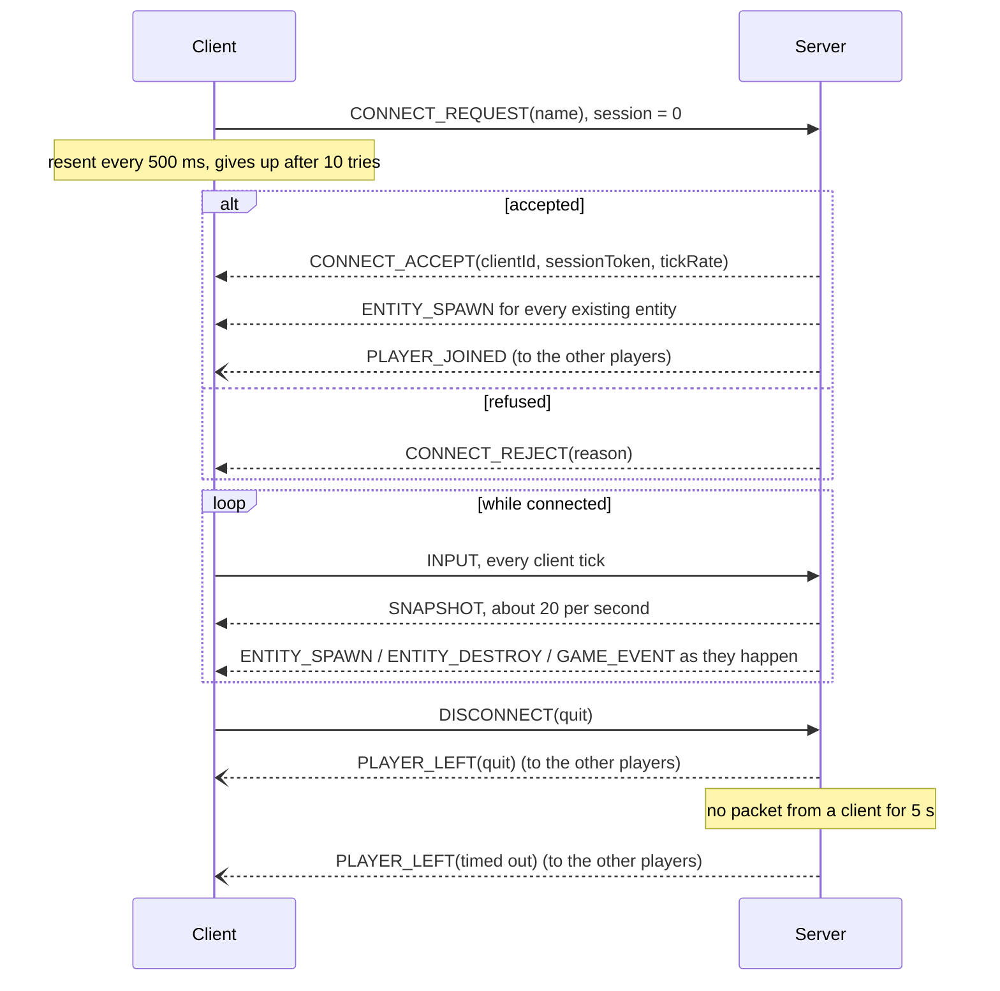

# R-Type network protocol

> Written so that someone could implement a new client from this document alone.

The key words MUST, MUST NOT, SHOULD and MAY are used as in RFC 2119.

## 1. Overview

- Transport: UDP. One socket per side, all traffic (connection, inputs, world updates, events) goes through it. The server listens on a port given on its command line.
- Model: the server is authoritative. Clients send their inputs; the server simulates the game and sends back what happened.
- Byte order: **big-endian** (network byte order) for every multi-byte field. Implementations MUST encode and decode field by field; copying a C/C++ struct to or from the wire is not allowed (padding and host byte order would leak into the format).
- Versioning: every packet carries a `version` byte, currently **`1`**. Any change to the packet layout or to an existing message increments it. A server MUST refuse a connection whose version differs from its own and MUST drop other packets with a wrong version.
- Maximum datagram size: **1200 bytes**, header included. This stays below common internet MTUs so packets are never fragmented. Senders MUST NOT exceed it; receivers MUST drop larger datagrams.
- Client implementation: the repository also ships a `NetworkClient` wrapper around this protocol. It manages the connection state machine, emits `Connected` / `Disconnected` / `ConnectionFailed` events, and is validated by loopback tests against a local server.

### 1.1 Data types

| Type | Size | Encoding |
|---|---|---|
| `u8` / `u16` / `u32` | 1 / 2 / 4 | Unsigned integer, big-endian. |
| `i16` / `i32` | 2 / 4 | Signed integer, two's complement, big-endian. |
| `bool` | 1 | `0` or `1`. Any other value makes the message invalid. |
| `string` | 1 + n | `u8` length `n`, then `n` bytes of UTF-8. No terminator. |
| `fixed` | 4 | `i32` in Q24.8: the value multiplied by 256. Used for positions (world units). |
| `fixed16` | 2 | `i16` in Q8.8: the value multiplied by 256. Used for velocities (world units per tick). |

Floating-point numbers are never sent.

### 1.2 Repository layout for the protocol implementation

The current implementation in this repository is organized around the following files:

- `network/protocol/include/Fixed.hpp`: fixed-point helpers for Q24.8 and Q8.8 values used in coordinates and velocities.
- `network/protocol/include/MessageType.hpp`: enum values for the message IDs used by the protocol.
- `network/protocol/src/Messages.hpp`: declarations for the game message payload types and validation helpers.
- `network/protocol/src/Messages.cpp`: serialization, deserialization and validation logic for each message.
- `network/protocol/CMakeLists.txt`: builds the protocol module in the project.
- `tests/protocol_messages_test.cpp`: round-trip and rejection tests covering the message layout and invalid inputs.

This module is the canonical implementation used to validate the wire format described in this document.

## 2. Packet header

Every datagram starts with this 16-byte header, followed by zero or more messages until the end of the datagram.

| Offset | Size | Field | Description |
|--------|------|-------|-------------|
| 0 | 2 | `magic` | Always `0x5254` (ASCII "RT"). |
| 2 | 1 | `version` | Protocol version, `1`. |
| 3 | 1 | `flags` | Reserved. MUST be `0`. |
| 4 | 4 | `session` | Session token received in `CONNECT_ACCEPT`. `0` in `CONNECT_REQUEST`. |
| 8 | 2 | `sequence` | Sequence number of this packet, incremented by the sender for every packet, wraps from 65535 to 0. |
| 10 | 2 | `ack` | Most recent `sequence` received from the peer. |
| 12 | 4 | `ackBits` | Bit `n` set means packet `ack - 1 - n` was also received (covers the 32 packets before `ack`). |

### 2.1 Message framing

After the header, the datagram holds messages back to back:

| Size | Field | Description |
|------|-------|-------------|
| 1 | `type` | Message type (§3). |
| 1 | `channel` | `0` unreliable, `1` reliable. Any other value: invalid. |
| 2 | `reliableId` | Present **only** when `channel` is `1`. Identifies the message for deduplication; incremented by the sender for every new reliable message, wraps at 65535. |
| 2 | `length` | Payload size in bytes. |
| `length` | payload | Layout depends on `type` (§3). |

### 2.2 Sequence numbers

Sequence numbers and reliable IDs wrap around. `a` is more recent than `b` when `(int16)(a - b) > 0`, computed on 16 bits. A plain `a > b` comparison is wrong after a wrap.

The implementation MUST use a wrap-safe comparison helper for 16-bit sequence values, for example:

- `sequenceGreater(a, b)` returns true when `a` is newer than `b` across the `0..65535` rollover boundary.
- `0` and `65535` are adjacent on wrap; a packet with sequence `0` is considered newer than one with sequence `65535` when compared in the correct modulo-16-bit order.

This rule is used for packet ordering and duplicate detection, and it is covered by unit tests for the rollover boundary.

### 2.3 Acknowledgements and reliability

- There is no separate ACK message: each side acknowledges what it received through `ack` / `ackBits` in the header of its next packet. A side with nothing else to send SHOULD send a packet with no messages within 100 ms so acknowledgements keep flowing.
- **Unreliable** messages are sent once. Losing one is harmless because a newer one replaces it (`INPUT`, `SNAPSHOT`, `PING`).
- **Reliable** messages are kept by the sender and copied into new packets until a packet containing them is acknowledged. If one stays unacknowledged for 5 seconds, the sender considers the peer disconnected.
- The receiver MUST process each `reliableId` only once and drop repeats.
- Reliable messages are **not** guaranteed to arrive in order. A client receiving a `SNAPSHOT` entry or `ENTITY_DESTROY` for an entity it doesn't know yet MUST ignore it.
- Because `entityId`s are never reused, a client SHOULD remember recently destroyed IDs and ignore an `ENTITY_SPAWN` that arrives after the matching `ENTITY_DESTROY`.

## 3. Messages

Types `0x01`–`0x0F` are connection messages, `0x10` and up are game messages. Unknown types make the datagram invalid (§5).

Every payload MUST be exactly `length` bytes: a payload that is too short **or** has bytes left over is invalid.

### 3.1 Client → Server

#### `0x01` CONNECT_REQUEST (unreliable, resent by the client, see §4)

| Field | Type | Description |
|---|---|---|
| `name` | `string` | Player name, 1 to 32 bytes. |

Sent with `session = 0`.

#### `0x04` DISCONNECT (reliable)

| Field | Type | Description |
|---|---|---|
| `reason` | `u8` | `0` quit. |

#### `0x05` PING (unreliable)

| Field | Type | Description |
|---|---|---|
| `timestamp` | `u32` | Sender's clock in milliseconds. The peer answers with `PONG`. |

#### `0x06` PONG (unreliable)

| Field | Type | Description |
|---|---|---|
| `timestamp` | `u32` | The `timestamp` of the `PING` being answered. |

#### `0x10` INPUT (unreliable, every client tick)

| Field | Type | Description |
|---|---|---|
| `clientTick` | `u32` | Client tick counter, increasing. The server ignores inputs older than the last one it applied. |
| `buttons` | `u8` | Bit 0 up, bit 1 down, bit 2 left, bit 3 right, bit 4 shoot. Bits 5–7 MUST be `0`. |

The client sends the current state of its controls, not key presses. A lost `INPUT` is replaced by the next one.

### 3.2 Server → Client

`DISCONNECT`, `PING` and `PONG` are also sent by the server, with the same layout as in §3.1. A server `DISCONNECT` uses reason `2` (kicked) or `3` (server shutting down).

#### `0x02` CONNECT_ACCEPT (reliable)

| Field | Type | Description |
|---|---|---|
| `clientId` | `u8` | Identifier of this player for the rest of the game. |
| `sessionToken` | `u32` | Random, non-zero. The client MUST put it in the `session` field of every later packet. |
| `tickRate` | `u8` | Server simulation rate in ticks per second. |

#### `0x03` CONNECT_REJECT (unreliable)

| Field | Type | Description |
|---|---|---|
| `reason` | `u8` | `1` server full, `2` version mismatch, `3` banned. |

#### `0x11` PLAYER_JOINED (reliable)

| Field | Type | Description |
|---|---|---|
| `clientId` | `u8` | The player who joined. |
| `name` | `string` | Their name. |

#### `0x12` PLAYER_LEFT (reliable)

| Field | Type | Description |
|---|---|---|
| `clientId` | `u8` | The player who left. |
| `reason` | `u8` | `0` quit, `1` timed out (crash or network loss), `2` kicked. |

#### `0x13` ENTITY_SPAWN (reliable)

| Field | Type | Description |
|---|---|---|
| `entityId` | `u32` | Unique for the lifetime of the game. |
| `entityType` | `u16` | Kind of entity (player ship, enemy type, missile…), see the game's entity list. |
| `x`, `y` | `fixed`, `fixed` | Initial position. |

#### `0x14` ENTITY_DESTROY (reliable)

| Field | Type | Description |
|---|---|---|
| `entityId` | `u32` | Entity to remove. |
| `cause` | `u8` | `0` left the screen, `1` killed, `2` other. |

#### `0x15` SNAPSHOT (unreliable, about 20 per second)

| Field | Type | Description |
|---|---|---|
| `serverTick` | `u32` | Server tick of this snapshot. A client MUST ignore a snapshot older than the last one it applied. |
| `count` | `u16` | Number of entries that follow. |
| entries | `count` × 16 bytes | Each: `entityId u32`, `x fixed`, `y fixed`, `vx fixed16`, `vy fixed16`. |

`count` MUST match the payload size exactly (`6 + 16 × count` bytes). If the world doesn't fit in one datagram, the server sends several `SNAPSHOT` messages with the same `serverTick`.

#### `0x16` GAME_EVENT (reliable)

| Field | Type | Description |
|---|---|---|
| `event` | `u8` | `0` shoot, `1` hit, `2` kill, `3` player death. |
| `sourceId` | `u32` | Entity causing the event. |
| `targetId` | `u32` | Entity affected, or `0` if none. |

## 4. Connection lifecycle

1. **Connecting.** The client sends `CONNECT_REQUEST` with `session = 0` and repeats it every 500 ms until it gets an answer, up to 10 times. A server receiving a repeat from an endpoint it already accepted resends the same `CONNECT_ACCEPT`.
2. **Session.** After `CONNECT_ACCEPT`, every packet in both directions carries the `sessionToken`. The server identifies a client by its address, port **and** token; packets that don't match an existing session are dropped. This prevents someone from injecting packets for another player by faking their address.
3. **Keep-alive.** A side that has sent nothing for 1 second sends a `PING`. This keeps an idle but alive player from timing out, and the `PING`/`PONG` pair measures round-trip time.
4. **Leaving.** A client that quits sends `DISCONNECT` and stops after it is acknowledged or after 3 attempts. The server tells the other players with `PLAYER_LEFT(quit)`.
5. **Timeout.** If the server receives nothing from a client for 5 seconds (crash, network loss), it removes that client and sends `PLAYER_LEFT(timed out)` to the others. The game continues for the remaining players. A client that hears nothing from the server for 5 seconds considers itself disconnected.

## 5. Error handling

How malformed, truncated or oversized packets are handled.

The receiver checks each datagram in this order. The first failed check drops the **whole datagram** silently: no reply, no partial processing.

1. Size below 16 bytes or above 1200 bytes.
2. `magic` is not `0x5254`, `flags` is not `0`, or `version` is not `1`. Exception: a `CONNECT_REQUEST` with a wrong version gets a `CONNECT_REJECT(version mismatch)` if the rest of it can be read.
3. On the server: the sender is unknown and the first message is not `CONNECT_REQUEST`, or the sender is known but `session` doesn't match its token.
4. A message header or payload runs past the end of the datagram, `channel` is not `0` or `1`, or `type` is unknown.
5. A payload doesn't decode to exactly `length` bytes, or a field is out of range: `bool` not 0/1, string empty or over 32 bytes, unknown enum value, reserved bits set, `SNAPSHOT.count` not matching the payload size.

The header decoder MUST reject these cases explicitly:

- `TooShort`: data pointer is null or the datagram is shorter than the 16-byte header.
- `TooLong`: the datagram is larger than 1200 bytes.
- `BadMagic`: the first 2 bytes are not `0x5254`.
- `BadVersion`: the version byte is not `1`.
- `BadFlags`: the flags byte is not zero.

All header validation happens before any message payload is parsed, and all invalid packets are discarded without partial processing.

Implementation requirements:

- Never trust a length or count field for allocation. Every size is checked against the bytes actually received before reading or reserving memory. One fixed 1200-byte receive buffer per socket is enough.
- A malformed packet MUST NOT crash the program, throw an uncaught exception, or make memory grow.
- The server limits how many packets per second it accepts from one address, how many connection attempts can be pending, and how many reliable messages can wait for acknowledgement per client. Packets over a limit are dropped. A client that keeps exceeding them is disconnected with `DISCONNECT(kicked)`.
- Duplicate and out-of-date packets are normal on UDP and are not errors: they are handled by §2.2 and §2.3.
